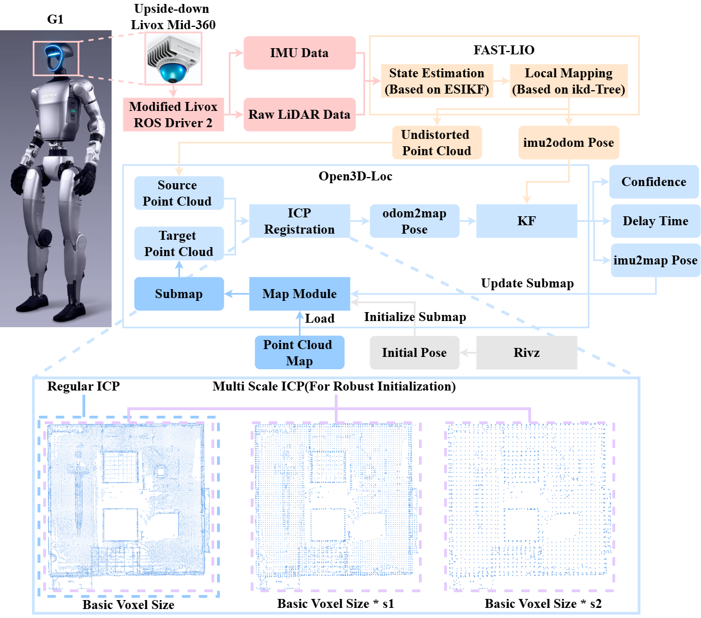
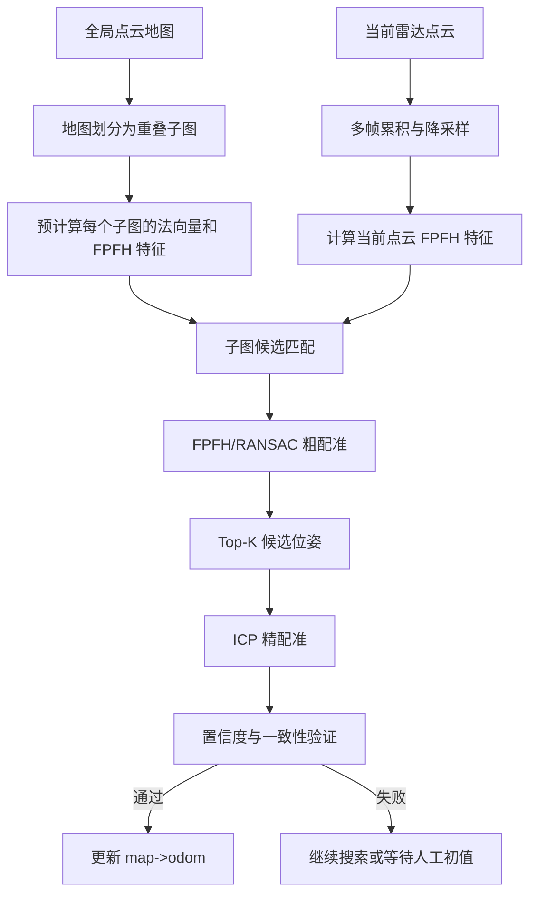
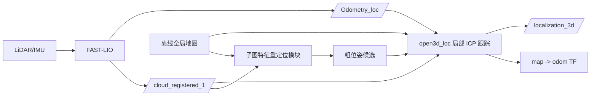
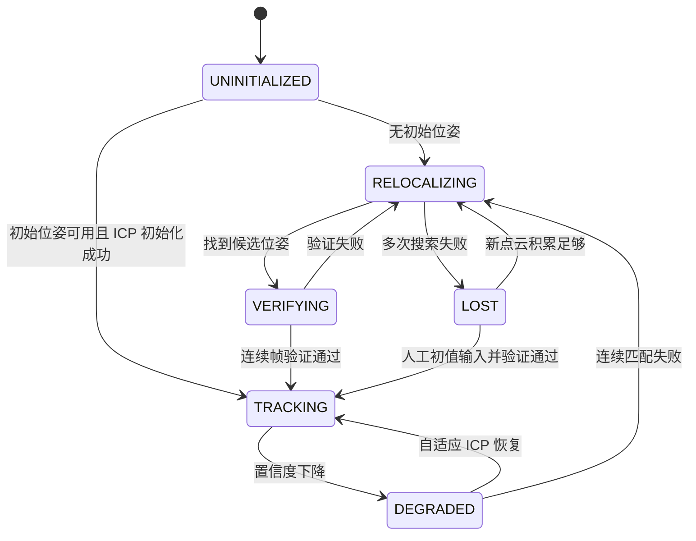
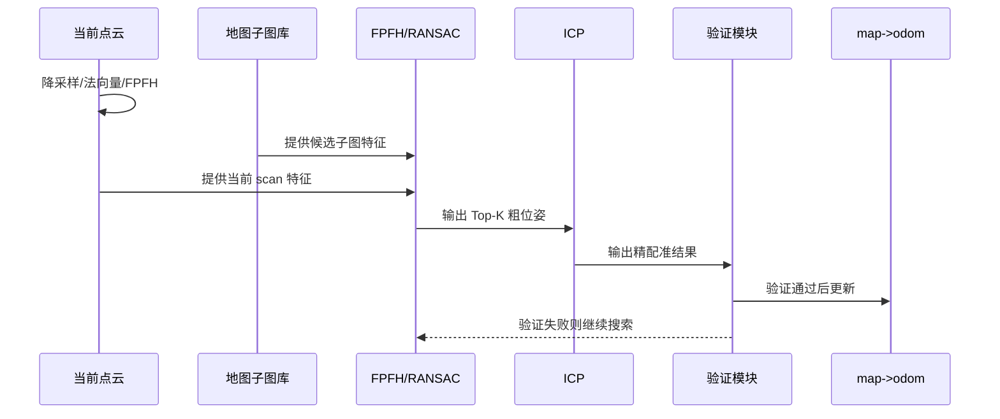

# 基于子图特征检索的 FAST-LIO Localization 自动重定位技术方案

## 1. 背景与问题

当前 `fastliolocalization` 的定位流程可以概括为：

```text
FAST-LIO 输出里程计和点云
-> open3d_loc 根据初始位姿建立 map->odom
-> 当前点云与局部地图子图进行 ICP 配准
-> 更新全局定位结果
```

现有系统在初始位姿较准确、FAST-LIO 漂移较小时效果较好，但在实际运行中存在两个关键问题：

1. 需要人工给定初始位姿  
   如果没有手动给 `/initialpose`，系统缺少可靠的全局初值，局部 ICP 很难知道应该去地图哪里匹配。

2. 长廊等退化环境容易漂移  
   长廊、平墙、玻璃、动态人群等场景中，FAST-LIO 可能发生漂移或短时退化。此时局部 ICP 的初值变差，容易匹配失败，甚至错误更新 `map->odom`。

项目现有定位效果示意：

<p align="center">
  
</p>

## 2. 总体思路

针对上述问题，引入“地图子图特征检索 + FPFH/RANSAC 粗配准 + ICP 精配准”的自动重定位机制。

核心思想是：

```text
提前把全局地图切成多个子图，并预计算每个子图的几何特征。

当没有初始位姿，或者运行中定位失效时，
系统对当前雷达扫描点云计算同样的特征，
再与地图子图进行匹配，找到最可能的位置，
然后用 ICP 进一步精细对齐。
```

整体流程如下：



## 3. 方法定位

本方案不是替代 FAST-LIO，而是在 FAST-LIO Localization 外层增加一个全局恢复能力。

FAST-LIO 仍负责短时间连续运动估计；`open3d_loc` 仍负责地图约束下的全局定位；新增模块负责在初始位姿缺失或定位退化时提供可靠粗位姿。



## 4. 关键概念通俗解释

### 4.1 FPFH 的作用

FPFH 可以理解为点云中每个点的“局部几何指纹”。

它不关心这个点在地图坐标中的绝对位置，而是描述这个点周围的局部形状，例如：

- 平墙
- 墙角
- 门框
- 台阶边缘
- 柱子边缘
- 地面和墙面的交线

系统会给地图子图和当前雷达点云都计算 FPFH 特征。若当前点云中的局部几何特征与某个地图子图相似，就说明当前机器人可能位于该地图区域。

```text
FPFH 解决的问题：
在不知道初始位姿时，先判断“当前看到的场景像地图里的哪个区域”。
```

### 4.2 RANSAC 的作用

FPFH 匹配会产生很多候选点对，但其中有不少是错误匹配。RANSAC 的作用是从大量真假混杂的匹配中，随机采样并反复验证，找到最能让两团点云整体对齐的粗变换。

```text
FPFH：找到可能对应的点
RANSAC：从这些对应关系中估计一个较可靠的粗位姿
```

### 4.3 ICP 的作用

ICP 是点云精配准方法。

它要求输入一个大致正确的初始位姿，然后反复寻找两团点云之间的最近点对应关系，并不断微调旋转和平移，使当前点云尽可能贴合地图子图。

```text
FPFH/RANSAC 负责“先放到大概正确的位置”；
ICP 负责“在这个基础上精细对齐”。
```

## 5. 新定位状态机

新增状态机用于区分正常跟踪、退化恢复和全局重定位。



状态说明：

| 状态 | 含义 | 主要动作 |
| --- | --- | --- |
| `UNINITIALIZED` | 尚未建立可靠全局位姿 | 等待人工初值或自动重定位 |
| `TRACKING` | 正常跟踪 | FAST-LIO 预测 + 局部 ICP 修正 |
| `DEGRADED` | 定位质量下降 | 增大子图、多尺度 ICP、提高更新频率 |
| `RELOCALIZING` | 自动重定位 | FPFH/RANSAC 子图检索 + ICP 精配准 |
| `VERIFYING` | 候选验证 | 连续帧一致性和质量门控 |
| `LOST` | 暂时丢失 | 不强制更新位姿，等待更多观测或人工初值 |

## 6. 详细实现流程

### 6.1 地图预处理

启动定位节点时，对离线地图进行预处理：

1. 读取全局点云地图。
2. 按固定间距划分为多个重叠子图。
3. 每个子图进行降采样。
4. 估计子图点云法向量。
5. 计算子图 FPFH 特征。
6. 缓存子图中心、范围、点云和特征。


建议子图采用重叠滑窗，而不是完全不重叠切块，避免机器人位于子图边界时匹配效果下降。

### 6.2 正常局部跟踪

正常状态下不需要每帧使用 FPFH/RANSAC，否则计算量较大。

正常流程仍然是：

```text
FAST-LIO odom 提供预测位姿
-> 当前点云裁剪
-> 地图局部子图裁剪
-> ICP 精配准
-> 通过质量判断后更新 map->odom
```

### 6.3 定位退化检测

系统通过多指标判断定位是否退化，避免只依赖单一 `fitness`。

推荐指标：

| 指标 | 作用 |
| --- | --- |
| ICP fitness | 判断重叠比例是否足够 |
| ICP inlier RMSE | 判断匹配误差是否过大 |
| 位姿跳变量 | 防止错误匹配造成突然跳变 |
| 当前点云点数 | 点太少时匹配不可靠 |
| 地图子图点数 | 子图信息不足时匹配不可靠 |
| 连续失败次数 | 避免单帧偶然失败直接触发重定位 |

退化判断示意：

```text
如果连续 N 次满足：
fitness 低 或 rmse 高 或 位姿跳变异常
则认为局部跟踪失效，进入 RELOCALIZING。
```

### 6.4 自动重定位

进入 `RELOCALIZING` 后，系统不再只依赖当前 `map->odom` 预测位置，而是使用当前雷达点云与地图子图进行特征匹配。

推荐分层搜索策略：

```text
第一层：搜索当前预测位置附近子图
第二层：扩大搜索半径
第三层：全局子图 Top-K 搜索
```

这样可以兼顾速度和鲁棒性。

具体流程：

1. 累积最近若干帧当前点云，形成局部 scan。
2. 对当前 scan 降采样、估计法向量、计算 FPFH。
3. 当前 scan 与候选地图子图做 FPFH/RANSAC。
4. 得到多个粗位姿候选。
5. 对 Top-K 候选分别执行 ICP。
6. 根据综合评分选择最优位姿。
7. 通过门控验证后更新 `map->odom`。



### 6.5 重定位结果验证

FPFH/RANSAC 只能生成候选位姿，不能保证一定正确。因此重定位结果必须经过验证。

建议验证条件：

1. ICP 后 fitness 高于阈值。
2. ICP 后 RMSE 低于阈值。
3. 最优候选明显优于第二候选。
4. 位姿跳变量符合物理运动约束。
5. 连续 3 到 5 帧重定位结果落在同一区域。

只有满足验证条件，才更新 `map->odom`；否则保持 `LOST` 或继续搜索，避免错误重定位。

## 7. 与现有代码的对应关系

建议主要在 `open3d_loc` 包内实现，尽量不改 FAST-LIO 主体。

| 模块 | 现有位置 | 改造内容 |
| --- | --- | --- |
| FAST-LIO 里程计输出 | `FAST_LIO/src/laserMapping.cpp` | 保持不变，继续输出 `/Odometry_loc` |
| 当前点云输出 | `FAST_LIO/src/laserMapping.cpp` | 保持不变，继续输出 `/cloud_registered_1` |
| 局部 ICP 定位 | `open3d_loc/src/global_localization.cpp` | 增加状态机、置信度、退化判断 |
| Open3D 配准工具 | `open3d_loc/src/open3d_registration/open3d_registration.cpp` | 复用 FPFH/RANSAC/ICP 接口，必要时扩展返回评分 |
| 参数配置 | `open3d_loc/launch/open3d_loc_go2.launch.py` | 增加子图尺寸、搜索半径、重定位阈值等参数 |

## 8. 建议新增参数

| 参数 | 含义 | 示例 |
| --- | --- | --- |
| `enable_relocalization` | 是否启用自动重定位 | `true` |
| `submap_size_xy` | 子图平面尺寸 | `30.0` |
| `submap_size_z` | 子图高度 | `8.0` |
| `submap_overlap_ratio` | 子图重叠比例 | `0.5` |
| `relocalization_fail_count` | 连续失败触发重定位次数 | `3` |
| `relocalization_search_radii` | 分层搜索半径 | `[20.0, 40.0, 80.0]` |
| `relocalization_top_k` | 保留候选数量 | `5` |
| `verify_frame_count` | 连续验证帧数 | `3` |
| `max_pose_jump_xy` | 最大允许平面跳变 | `5.0` |
| `max_pose_jump_yaw_deg` | 最大允许 yaw 跳变 | `30.0` |

## 9. 预期效果

改造后系统将具备以下能力：

1. 有初始位姿时，继续快速完成局部 ICP 初始化。
2. 无初始位姿时，可尝试通过地图子图特征检索自动初始化。
3. 长廊退化或 FAST-LIO 漂移时，可先进入退化跟踪，再触发自动重定位。
4. 错误匹配不会直接更新全局位姿，而是通过多指标和连续帧验证过滤。

定位能力变化如下：

```text
原始方案：
人工初始位姿 -> 局部 ICP 跟踪 -> 失败后通常需要人工重新初始化

改进方案：
人工初始位姿可选 -> 局部 ICP 跟踪 -> 退化检测 -> 子图特征重定位 -> 自动恢复
```

## 10. 实验验证建议

建议设计四组对比实验：

| 实验组 | 内容 |
| --- | --- |
| Baseline | 原始 `open3d_loc` 固定 ICP |
| Ours-A | 增加置信度与退化检测 |
| Ours-B | 增加 FPFH/RANSAC 自动重定位 |
| Ours-Full | 置信度检测 + 自适应 ICP + 自动重定位 |

评价指标：

- 初始化成功率
- 重定位成功率
- 定位恢复时间
- 平均定位耗时
- ICP fitness / RMSE
- 错误重定位次数
- 轨迹误差，若有参考轨迹可计算 ATE/RPE

典型测试场景：

1. 正常初始位姿定位。
2. 不给初始位姿冷启动。
3. 长廊直线运动导致退化。
4. 人为注入初始位姿偏差。
5. 动态物体较多场景。
6. 相似走廊或重复结构场景。

## 11. 风险与控制

| 风险 | 原因 | 控制方式 |
| --- | --- | --- |
| FPFH 误匹配 | 长廊和墙角结构重复 | Top-K 候选、候选差距判断、连续帧验证 |
| 全局搜索耗时高 | 地图子图数量多 | 先局部半径搜索，再全局搜索 |
| 冷启动不稳定 | 当前点云视野太小 | 多帧累积后再重定位 |
| 错误更新 map->odom | 单次配准结果不可靠 | fitness、RMSE、跳变、一致性联合门控 |
| 参数较多 | 场景尺度不同 | 先固定推荐值，再通过实验调参 |

## 12. 总结

本方案针对现有 `fastliolocalization` 依赖人工初始位姿、长廊退化和漂移后难以自动恢复的问题，引入地图子图特征检索和自动重定位机制。

方案核心是：

```text
平时用 FAST-LIO + 局部 ICP 保持实时定位；
失效时用 FPFH/RANSAC 在地图子图中找回粗位姿；
再用 ICP 精配准；
最后通过置信度和连续帧一致性验证后更新全局位姿。
```

该改造不需要重写 FAST-LIO 主体，主要集中在 `open3d_loc` 层，具备较好的工程可行性和论文展开空间。
