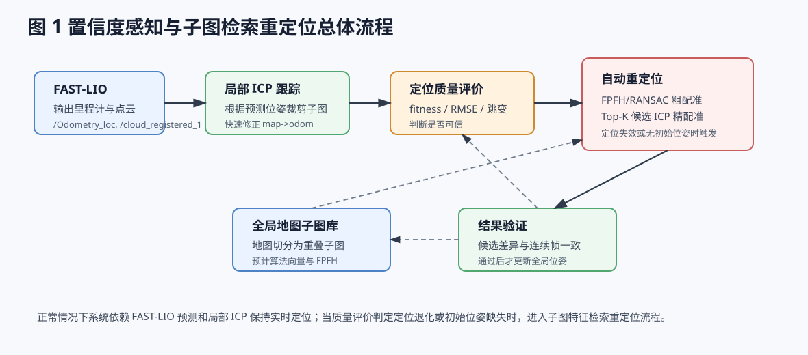
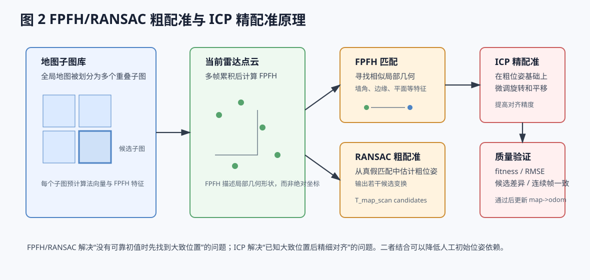

# 周报：FAST-LIO Localization 自动重定位方案设计

## 1. 本周工作目标

针对当前 `fastliolocalization` 依赖人工初始位姿、长廊场景容易退化漂移的问题，调研并设计一种基于地图子图特征检索的自动重定位方案，使系统在无初始位姿或定位失效时，能够自动恢复全局定位。

## 2. 当前问题

现有定位流程主要依赖 FAST-LIO 输出的里程计和当前点云，再通过局部 ICP 与离线地图子图配准，更新 `map->odom`。

该方式存在两个问题：

- **需要人工初始位姿**：没有初始位姿时，ICP 不知道应该去地图哪个区域匹配。
- **长廊退化后容易漂移**：长廊、平墙等场景几何约束弱，FAST-LIO 漂移后会导致 ICP 初值变差，进而匹配失败。

## 3. 解决思路

本方案引入“地图子图特征检索 + FPFH/RANSAC 粗配准 + ICP 精配准”的自动重定位流程。

核心逻辑如下：

1. 预先将全局地图划分为多个重叠子图。
2. 提前计算每个子图的几何特征。
3. 当系统没有初始位姿，或检测到定位失效时，计算当前雷达点云的几何特征。
4. 将当前点云特征与地图子图特征进行匹配，找到可能所在区域。
5. 通过 RANSAC 得到粗位姿。
6. 再用 ICP 做精细配准。
7. 验证通过后更新 `map->odom`，恢复全局定位。



## 4. 关键方法解释

**FPFH：局部几何特征**

FPFH 可以理解为点云的“局部几何指纹”。它描述一个点周围的几何形状，例如墙角、平面、门框、边缘等。它的作用是帮助系统判断“当前雷达看到的场景像地图中的哪个区域”。

**RANSAC：粗配准**

FPFH 匹配会产生很多候选点对，其中包含错误匹配。RANSAC 会从这些候选关系中反复采样和验证，估计一个较可靠的粗位姿。

**ICP：精配准**

ICP 用于在粗位姿基础上进一步微调点云位置。它通过反复寻找两团点云的最近点关系，优化旋转和平移，使当前点云更准确地贴合地图子图。

简单理解：

```text
FPFH/RANSAC：先找到大概位置
ICP：再把位置对准
```



## 5. 系统运行逻辑

系统可以分为三种工作状态：

| 状态 | 说明 | 处理方式 |
| --- | --- | --- |
| 正常定位 | FAST-LIO 位姿可靠 | 使用局部 ICP 快速修正 |
| 定位退化 | ICP 质量下降或位姿跳变异常 | 增大子图范围，尝试多尺度 ICP |
| 定位失效 | 连续多次匹配失败或无初始位姿 | 触发 FPFH/RANSAC 自动重定位 |

自动重定位成功后，系统不会立即完全信任单次结果，而是继续检查 ICP 质量、位姿跳变和连续帧一致性。只有结果稳定后，才更新 `map->odom`。

## 6. 相比原系统的改进

原系统：

```text
人工初始位姿 -> 局部 ICP 跟踪 -> 失败后通常需要重新给初值
```

改进后：

```text
初始位姿可选 -> 局部 ICP 跟踪 -> 退化检测 -> 子图特征重定位 -> 自动恢复
```

主要改进点：

- 降低对人工初始位姿的依赖。
- 提高长廊等退化场景下的恢复能力。
- 避免单纯依赖固定 ICP 阈值判断定位是否成功。
- 为后续论文实验提供可对比的算法模块。

## 7. 后续计划

下一步计划在 `open3d_loc` 中实现以下模块：

1. 地图子图划分与 FPFH 特征缓存。
2. 定位质量评价与失效触发条件。
3. FPFH/RANSAC 子图粗配准。
4. Top-K 候选 ICP 精配准。
5. 连续帧验证与 `map->odom` 更新逻辑。

## 8. 风险与注意事项

- 长廊和重复房间可能出现相似特征，FPFH/RANSAC 可能误匹配。
- 因此不能只依赖单次 FPFH/RANSAC 结果，必须结合 ICP 质量和连续帧一致性验证。
- 大地图全局搜索计算量较大，建议先搜索当前位置附近子图，失败后再扩大搜索范围。

## 9. 本周结论

本周确定了针对 `fastliolocalization` 的改进方向：在原有 FAST-LIO + 局部 ICP 定位框架基础上，引入地图子图特征检索和自动重定位机制。该方案能够针对无初始位姿和长廊退化漂移问题提供更强的全局恢复能力，且主要改动集中在 `open3d_loc` 层，具备较好的实现可行性。
