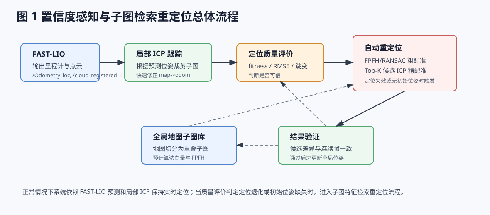
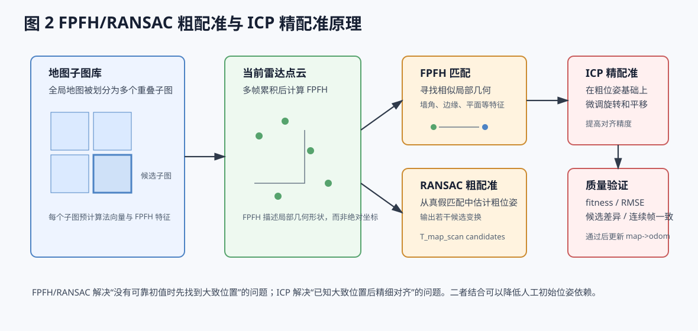

# 基于子图特征检索的 FAST-LIO Localization 自动重定位方法

## 1 问题提出

在移动机器人三维定位任务中，FAST-LIO 可以利用 LiDAR 与 IMU 信息提供连续的里程计估计，并在短时间内保持较好的运动连续性。现有 `fastliolocalization` 在此基础上进一步引入离线点云地图，通过当前点云与地图局部子图之间的 ICP 配准来修正全局位姿，从而建立并维护 `map->odom` 坐标变换。该方法在初始位姿较准确、场景几何结构丰富的情况下能够取得较好的定位效果。

然而，在实际机器人运行过程中，现有方法仍然存在明显局限。首先，系统通常需要人工给定较准确的初始位姿，否则局部 ICP 无法判断当前雷达点云应该与地图中的哪个区域进行匹配。其次，在长廊、平墙、玻璃或动态行人较多的场景中，LiDAR 几何约束变弱，FAST-LIO 可能出现漂移或短时退化。此时局部 ICP 所依赖的初始位姿会变差，若继续采用固定范围的局部地图匹配，容易出现配准失败或错误收敛。

因此，本文针对现有系统“依赖人工初始位姿”和“退化场景下缺少自动恢复能力”的问题，提出一种基于地图子图特征检索的自动重定位方法。该方法的目标不是替代 FAST-LIO 的实时里程计能力，而是在 FAST-LIO 定位链路之外增加一个全局恢复机制，使系统在无初始位姿或运行中定位失效时，能够通过当前雷达观测自动找回其在全局地图中的位置。

## 2 方法动机

现有局部 ICP 定位方法的核心假设是：机器人已经大致知道自己在地图中的位置，ICP 只需要在这一初值附近进行小范围微调。换言之，ICP 更适合解决“如何对得更准”的问题，而不擅长解决“我现在在哪里”的问题。当初始位姿不存在或已经明显漂移时，ICP 的搜索范围有限，容易在错误区域内收敛。

为了突破这一限制，需要在 ICP 精配准之前增加一个粗定位阶段。该阶段不依赖精确初值，而是根据当前雷达点云的局部几何形状，在全局地图中寻找相似区域。FPFH 特征能够描述点云局部邻域的几何结构，例如墙角、边缘、平面和台阶等；RANSAC 则可以从大量候选特征匹配中估计当前点云与地图子图之间的粗略刚体变换。因此，FPFH/RANSAC 适合作为自动重定位中的粗配准模块，为后续 ICP 提供较可靠的初始位姿。

基于上述分析，本文采用“FPFH/RANSAC 粗配准 + ICP 精配准”的两阶段策略。其中，FPFH/RANSAC 负责在定位失效时从地图中找出可能位置，ICP 负责在候选位置附近进一步精细对齐。这样既保留了 ICP 的高精度优势，又降低了系统对人工初始位姿和 FAST-LIO 短时稳定性的依赖。

## 3 总体框架

本文方法的总体框架如图 1 所示。系统在启动时首先读取离线全局点云地图，并将其划分为多个具有重叠区域的局部子图。随后，对每个子图进行降采样、法向量估计和 FPFH 特征计算，形成可用于检索的地图子图库。在正常定位阶段，系统仍然沿用 FAST-LIO 里程计预测和局部 ICP 修正的方式，以保证实时性。

当系统检测到定位质量下降，或启动时没有可用初始位姿时，自动重定位模块被触发。此时系统对当前雷达扫描点云进行多帧累积，并计算其 FPFH 特征，然后与候选地图子图进行特征匹配。通过 RANSAC 估计当前点云相对于候选子图的粗位姿，再将若干个评分较高的候选结果送入 ICP 精配准模块。最终，系统根据配准质量和连续帧一致性判断该结果是否可信，只有验证通过后才更新 `map->odom` 变换。

该框架体现了分层定位思想：在定位正常时使用计算量较低的局部 ICP 跟踪；在定位退化时扩大匹配范围并增强配准鲁棒性；在定位失效或无初始位姿时，利用地图子图特征检索重新建立全局位姿。

## 4 地图子图构建与特征预计算

若直接将当前雷达点云与完整全局地图进行 FPFH/RANSAC 匹配，计算量较大，且在大地图中容易受到重复结构影响。因此，本文首先将全局点云地图划分为多个局部子图。每个子图覆盖一定空间范围，相邻子图之间保留重叠区域，以避免机器人位于子图边界时出现匹配不稳定的问题。

对每个地图子图，系统预先执行三个步骤。第一，对点云进行体素降采样，以减少点数并降低计算量。第二，估计点云法向量，因为 FPFH 特征依赖点与邻域之间的法向量关系。第三，计算并缓存子图 FPFH 特征。这样，在运行过程中进入重定位状态时，系统无需重复计算地图端特征，只需要计算当前点云特征并与子图库进行匹配。

这种预处理方式将一部分计算开销从在线阶段转移到系统启动阶段或离线阶段，有助于提升自动重定位的实时性。同时，子图化地图也为后续分层搜索提供了基础：系统可以优先搜索当前位置附近的子图，若匹配失败再扩大搜索范围，最后才进行全局候选搜索。

## 5 FPFH/RANSAC 粗配准原理

FPFH 可以理解为点云局部几何结构的描述子。对于点云中的某个点，FPFH 会分析该点邻域内其他点的空间分布及法向量变化，并将这些几何关系编码为一个特征向量。因此，FPFH 描述的是“该点周围长什么样”，而不是“该点在地图坐标系中的具体位置”。这使得当前雷达点云即使尚未与地图对齐，也可以通过局部几何形状与地图子图进行比较。

仅依靠 FPFH 特征匹配还不足以直接获得可靠位姿，因为不同区域可能存在相似的墙角、门框或长廊结构，特征匹配中会包含大量错误对应关系。RANSAC 的作用就是在这些真假混杂的对应关系中反复随机采样，估计候选刚体变换，并统计在该变换下能够正确对齐的点对数量。能够解释最多有效对应关系的变换，将被认为是较可靠的粗配准结果。

图 2 展示了粗配准与精配准之间的关系。FPFH/RANSAC 首先根据局部几何特征估计当前点云在地图中的大致位置；随后 ICP 在该粗位姿基础上进行迭代优化，使当前点云与地图子图更加精确地重合。

需要强调的是，FPFH/RANSAC 并不保证单次输出一定正确。它的作用是生成可能的全局位姿候选，而不是直接给出最终定位结果。因此，本文在粗配准之后引入 Top-K 候选筛选、ICP 精配准和多指标验证，以降低相似结构导致的误匹配风险。

## 6 ICP 精配准与结果验证

ICP 是一种点云精配准方法。其基本思想是在给定初始位姿的条件下，反复寻找当前点云与目标地图点云之间的最近点对应关系，并不断优化旋转和平移，使两组点云的整体距离最小。由于 ICP 只在初始位姿附近进行局部优化，因此它对初值较敏感，但在粗位姿较准确时能够获得较高的配准精度。

在本文方法中，ICP 不再承担全局搜索任务，而是作为 FPFH/RANSAC 之后的精配准模块。系统会从 RANSAC 输出中选择若干个评分较高的候选位姿，并分别执行 ICP 精配准。随后，根据 ICP 的 fitness、inlier RMSE、候选之间的分数差异以及位姿跳变量对结果进行综合判断。

为了避免错误重定位直接破坏全局坐标关系，本文不接受单帧配准结果直接更新 `map->odom`。只有当候选位姿在连续若干帧中保持一致，并且配准质量稳定满足阈值条件时，系统才认为重定位成功。否则，系统继续保持未定位或退化状态，等待更多雷达观测，或者接收人工初始位姿作为兜底输入。

## 7 状态切换逻辑

为了使系统在不同定位质量下采取不同策略，本文设计了定位状态机。系统启动时若存在人工初始位姿，则先在该位姿附近进行局部 ICP 初始化；若不存在初始位姿，则直接进入自动重定位状态。正常跟踪状态下，系统持续根据 FAST-LIO 里程计预测当前位姿，并利用局部地图 ICP 修正漂移。

当 ICP fitness 降低、RMSE 增大、位姿修正量异常或连续多帧配准失败时，系统进入退化状态。在退化状态下，系统可以增大地图子图范围、提高定位更新频率或采用多尺度 ICP，以尝试在局部范围内恢复稳定定位。如果退化持续存在，说明当前 `map->odom` 已经不再可靠，系统进入自动重定位状态。

自动重定位成功后，系统并不会立即完全恢复正常跟踪，而是进入短时间验证阶段。在该阶段，系统检查连续多帧定位结果是否稳定。如果验证通过，则恢复正常跟踪；如果验证失败，则继续重定位或进入定位丢失状态。这种状态切换机制可以降低偶然匹配成功带来的误更新风险。

## 8 相对于原系统的改进

与原有 `fastliolocalization` 相比，本文方法的主要改进体现在三个方面。第一，初始位姿由强依赖变为可选输入。当人工初始位姿存在时，系统可以快速初始化；当初始位姿不存在时，系统可以通过地图子图特征检索尝试自动初始化。第二，系统具备定位退化感知能力，不再仅依赖固定 ICP 阈值进行简单判断，而是综合考虑配准质量、位姿跳变和连续失败次数。第三，系统在定位失效后具备自动恢复能力，可以利用 FPFH/RANSAC 重新寻找全局粗位姿，并通过 ICP 精配准恢复全局定位。

该改进没有改变 FAST-LIO 的核心前端和状态估计过程，而是在 `open3d_loc` 全局定位层增加重定位能力。因此，该方案与现有代码结构具有较好的兼容性，主要实现工作集中在地图子图管理、特征缓存、重定位触发、候选配准和结果验证等模块。

## 9 小结

本文针对现有 FAST-LIO Localization 在无初始位姿和退化场景下容易定位失败的问题，提出了一种基于子图特征检索的自动重定位方法。该方法通过离线地图子图化与 FPFH 特征预计算，建立可检索的地图表示；在定位失效时，利用当前雷达点云与地图子图之间的 FPFH/RANSAC 粗配准生成候选位姿；随后通过 ICP 精配准和连续帧一致性验证确认最终定位结果。

整体而言，该方法形成了“正常状态局部 ICP 跟踪、退化状态自适应增强、失效状态全局重定位”的分层定位框架。它既保留了 FAST-LIO 的实时里程计优势，又增强了系统在长廊退化、初始位姿缺失和短时漂移情况下的全局恢复能力，为移动机器人长期稳定定位提供了一种可行的改进思路。
